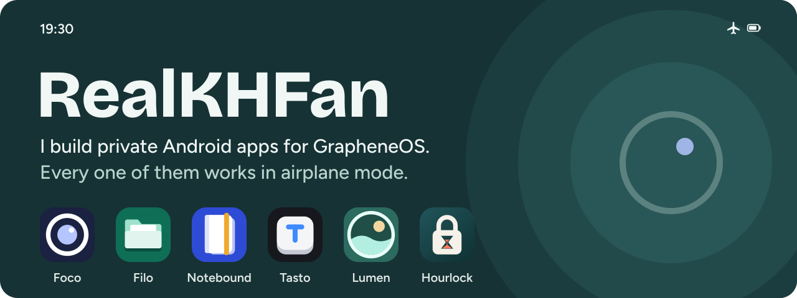
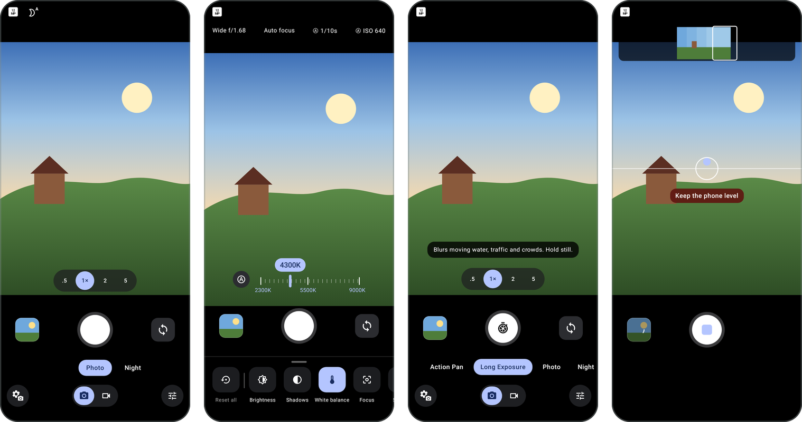
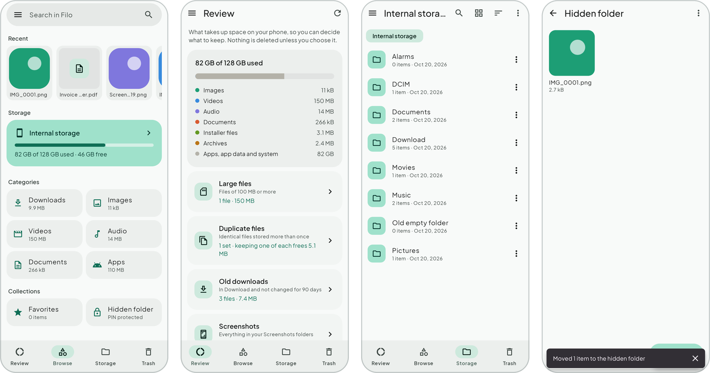
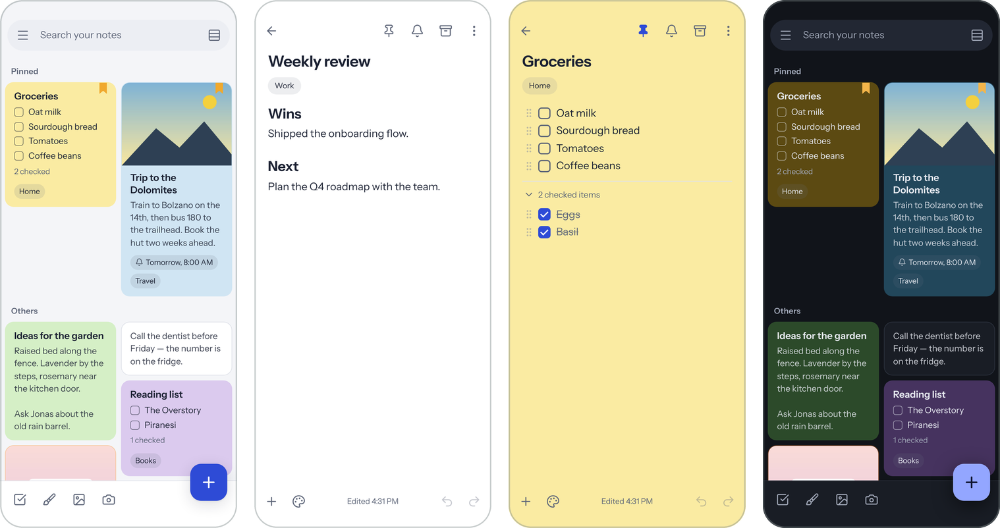
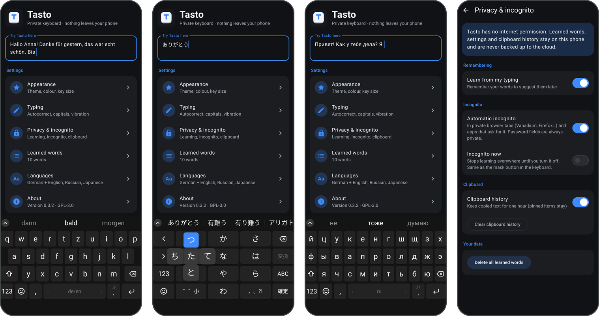
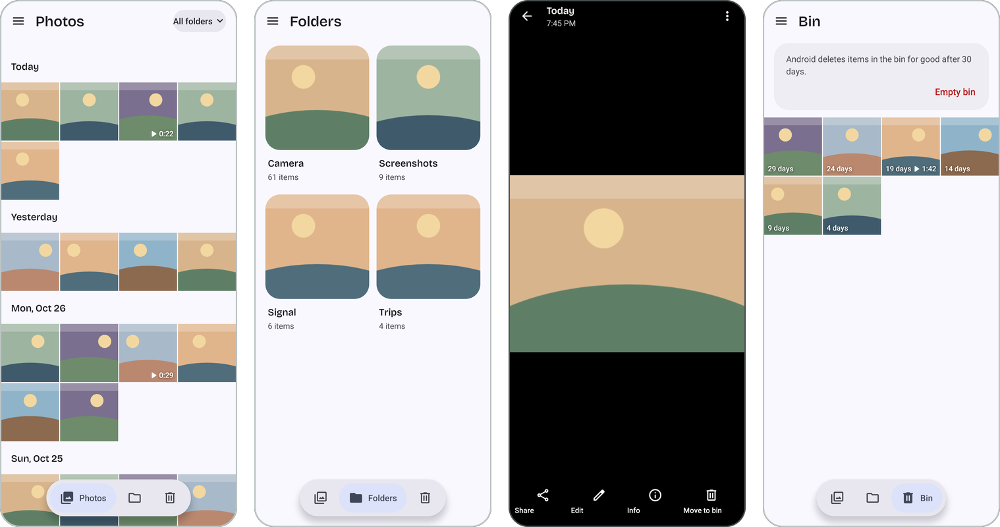

  
  
  
  

## About

I build open-source replacements for the Google apps on my own phone: camera, files, notes, keyboard, gallery and screen-time tools. They keep the Material You look people already know, run without Google Play Services, and none of them asks for internet access, so your photos, files, notes and what you type never leave the device.

They're made first for GrapheneOS on Pixel, and most of them run on any Android phone.

## Apps

<a href="https://github.com/RealKHFan/foco">
  <picture>
    <source media="(prefers-color-scheme: dark)" srcset="assets/apps/foco-dark.svg">
    
  </picture>
</a>

Laid out like Pixel Camera, without Google. Multi-frame HDR processing saved as Ultra HDR, Night mode, Long Exposure, Action Pan, Panorama, full pro controls and up to 4K 10-bit HDR video, built on CameraX.

&nbsp;

<a href="https://github.com/RealKHFan/filo">
  <picture>
    <source media="(prefers-color-scheme: dark)" srcset="assets/apps/filo-dark.svg">
    
  </picture>
</a>

In the style of Files by Google. Find large files and duplicates, restore from a 30-day trash, zip and unzip, and keep private files in a hidden folder locked with a PIN or fingerprint and encrypted with AES-256-GCM.

&nbsp;

<a href="https://github.com/RealKHFan/notebound">
  <picture>
    <source media="(prefers-color-scheme: dark)" srcset="assets/apps/notebound-dark.svg">
    
  </picture>
</a>

A Google Keep–style home screen and a rich editor: checklists, tables, LaTeX, drawings and version history. Every note is a plain HTML file in a folder you choose, locked notes are encrypted with AES-256-GCM, and you can import straight from Google Keep Takeout.

&nbsp;

<a href="https://github.com/RealKHFan/tasto">
  <picture>
    <source media="(prefers-color-scheme: dark)" srcset="assets/apps/tasto-dark.svg">
    
  </picture>
</a>

A SwiftKey-style keyboard for German, English, Russian and Japanese. German and English suggestions share one QWERTZ layout, and Japanese works through romaji or 12-key flick input with kana-to-kanji conversion. Tasto learns your words on the phone, lets you review and delete them, and goes incognito by itself in private browser tabs.

&nbsp;

<a href="https://github.com/RealKHFan/lumen">
  <picture>
    <source media="(prefers-color-scheme: dark)" srcset="assets/apps/lumen-dark.svg">
    
  </picture>
</a>

The Google Photos layout: a day-by-day timeline with pinch-to-zoom, folders, inline video, a lock-screen mode that only shows photos from the current camera session, and a bin you can restore from.

&nbsp;

<a href="https://github.com/RealKHFan/hourlock">
  <picture>
    <source media="(prefers-color-scheme: dark)" srcset="assets/apps/hourlock-dark.svg">
    
  </picture>
</a>

About 60 KB in size. Track usage, get warnings, set daily limits or block apps outright. Loosening a rule starts a 3-minute countdown, so limits can't be undone on impulse.

## Tools

  
  
  
  
  
  
  
  
  
  

## Contact

Found a bug or have an idea for one of the apps? Open an issue on that app's repository.
